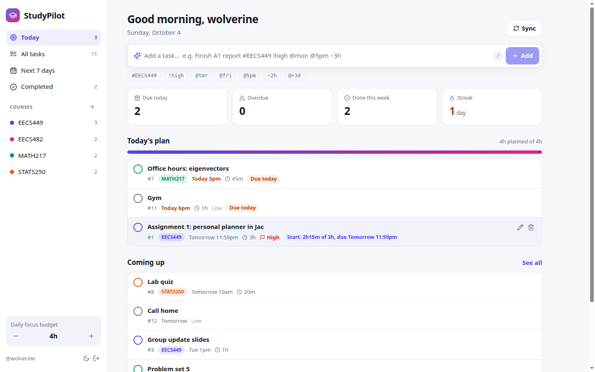
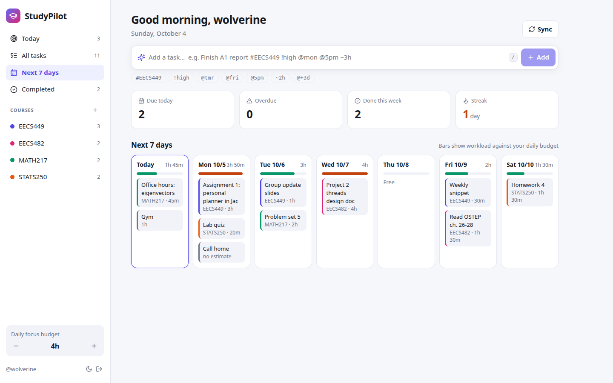
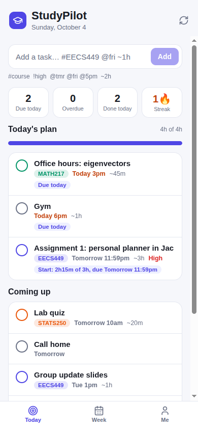

# StudyPilot

**A personal planner for coursework and life, written entirely in Jac.** One backend serves a web app, a phone app and a terminal CLI.

> **Name:** Yiyu Wang · **UMID:** 82560065 · EECS 449 Fall 2026 · Assignment 1 (Personal Planning App in Jac)



StudyPilot answers one question every morning: **"What should I work on today?"** Add tasks in one line, such as `Finish A1 report #EECS449 !high @mon @5pm ~3h`. StudyPilot files the task under its course, scores how urgent it is, and builds a plan for the day that fits your time budget. The plan lists everything that is due today first, then the most urgent upcoming work. When a big task does not fit, StudyPilot books the time you have left and labels it, for example *"Start: 2h15m of 3h, due Tomorrow 11:59pm"*.

| Web | Phone | Terminal |
|---|---|---|
|  |  | see [CLI](#3-cli) |

---

## Features

- **One-line quick add** works the same on web, phone and CLI: `#course`, `!high`/`!low`, `@tmr`/`@fri`/`@10/31`/`@+3d`, `@5pm`, `~2h` ([syntax](#quick-add-syntax)).
- **Smart daily plan.** Each task gets an urgency score from its priority, how close the deadline is, and its size. Overdue and due-today tasks always make the plan. The rest are added by urgency until your **daily focus budget** (default 4h, adjustable) runs out. A large task that doesn't fit is split, and its label tells you why it was picked.
- **Courses.** Tagging a task `#EECS449` creates the course on first use. Each course has its own color, a progress bar and a "next due" label, and gets its own page on the web.
- **Next 7 days** board with a workload bar for each day, measured against your budget (green, orange or red).
- **Progress stats:** due today, overdue, done this week, and a 🔥 streak of consecutive days with at least one task finished.
- **Accounts.** Every user has a private planning graph. The same login works on all three clients.
- **Persistence.** Data lives in Jac's graph store, so it survives server restarts.
- **Web extras:** edit modal (course, priority, date, time, estimate, notes), light/dark theme, and press `/` to jump to quick add.
- **Phone extras:** pull to refresh, and a bottom sheet with one-tap *Done / Today / Tomorrow / Next week / priority / Delete*.
- **CLI extras:** colored output, `plan week` workload bars, `plan edit`, and clear exit codes. It respects `NO_COLOR`.

---

## Quick start

### Prerequisites

- **Jac 0.37.23** (the version this project pins in `jac.toml`). The installer is one self-contained binary, so you don't need Python or Node.
  ```bash
  curl -fsSL https://raw.githubusercontent.com/jaseci-labs/jaseci/main/scripts/install.sh | bash -s -- --version 0.37.23
  source ~/.bashrc      # or open a new terminal
  jac --version         # jac 0.37.23
  ```
- Tested on Linux x86_64. You don't need API keys or any other configuration.

### 1. Web app + server

From the repository root:

```bash
jac run
```

Open **http://localhost:8000** and click **Create an account**.

On the first run, `jac run` installs the npm dependencies by itself, which takes a few seconds. It serves the web app and colocates the `planner` backend service in the same process. API docs are at `http://localhost:8000/docs`.

**Optional demo data** (with the server running, in a second terminal):

```bash
./plan signup demo --password demo1234
scripts/seed-demo.sh          # 4 courses and 13 tasks with relative due dates
```

Then sign in on the web or phone as `demo` / `demo1234`.

### 2. Mobile app

The mobile app is a native React Native app built with Jac's `@jac/mobui` component set. It uses no HTML, and it calls the same planner walkers as the web app.

**a) In a browser (quickest, works on a laptop or a phone's browser)**

```bash
jac run --platform web --port 8100 mobile
```

Open **http://localhost:8100**. On a phone on the same Wi-Fi network, open `http://<your-laptop-LAN-IP>:8100` instead. This command starts its own copy of the backend on the **same database**, so you can run it alongside `jac run`. Tasks you add on the phone show up on the web and in the CLI, and the other way around.

**b) On a real phone with Expo Go (native views)**

```bash
jac setup mobile          # one time: scaffolds the Expo project in .jac/mobile-rn
jac run --dev mobile      # starts Metro and a backend, prints a QR code
```

Install **Expo Go** from the App Store or Play Store and scan the QR code. The phone has to reach your laptop over the LAN. If the address it detects is wrong, set `JAC_RN_DEV_HOST=<laptop-ip>`.

**c) Android APK (optional):** run `jac build mobile --platform android`. Jac downloads the Android SDK for you, and you have to accept its license, either interactively or with `JAC_ACCEPT_ANDROID_LICENSES=1`.

### 3. CLI

`./plan` is a small launcher for `jac run cli -- <args>`. The server from step 1 must be running.

```bash
./plan signup alice                 # or: ./plan login alice   (the session is saved in ~/.config/studypilot)
./plan add Finish A1 report '#EECS449' '!high' @tmr @11:59pm '~3h'
./plan                              # today's plan (same as: ./plan today)
./plan week                         # next 7 days with workload bars
./plan ls --course EECS449          # open tasks grouped by due date
./plan done 3 7                     # check off tasks by number
./plan edit 4 --due 2026-10-09 --priority 3
./plan courses                      # progress per course
./plan budget 300                   # daily focus budget in minutes
./plan --help                       # every command
```

Example output:

```text
StudyPilot  ·  Sunday, October 4  ·  4h planned of 4h
  2 done today · 2 this week · 🔥 1-day streak

Today's plan
  #7   ○     Office hours: eigenvectors  MATH217  Today 3pm  ~45m  · Due today
  #11  ○ low Gym  Today 6pm  ~1h  · Due today
  #1   ○ !!! Assignment 1: personal planner in Jac  EECS449  Tomorrow 11:59pm  ~3h  · Start: 2h15m of 3h, due Tomorrow 11:59pm

Coming up  (plan ls for everything)
  #8   ○     Lab quiz  STATS250  Tomorrow 10am  ~20m
  #3   ○     Group update slides  EECS449  Tue 1pm  ~1h
```

To use the CLI against another server, pass `--server URL` or set `STUDYPILOT_SERVER`. Tip: `alias plan="$PWD/plan"`.

### 4. Check that the parts work together (about 5 minutes)

Changes made on one client show up on the others after you click **Sync** on the web or pull to refresh on the phone.

1. **Web.** Run `jac run`, open http://localhost:8000, create the account `tester`, then quick-add `Read ch.4 #EECS449 !high @tmr ~1h`. It is filed under the course **EECS449** and due **Tomorrow**.
2. **CLI.** In a second terminal, run `./plan login tester`, then `./plan add Lab report '#EECS370' @fri '~2h'` and `./plan done 1`. In the browser, click **Sync**: the new task and the check mark both appear.
3. **Mobile.** In a third terminal, run `jac run --platform web --port 8100 mobile`, open http://localhost:8100 and sign in as `tester`. You see the same tasks. Tap a task, choose **Tomorrow**, then **Sync** the web app to see the new date.
4. **Persistence.** Stop `jac run` with Ctrl+C, start it again and sign in. Everything is still there.
5. **Tests.** `jac test` reports 37 passed.

---

## How the four parts fit together

```
                 ┌────────────────── one Jac workspace (jac.toml) ──────────────────┐
                 │                                                                   │
  browser ──▶ web/  (kind web-app) ──┐                                               │
                                     │  plain `import from core.planner {...}`;      │
  phone  ───▶ mobile/ (kind mobile) ─┼─ the compiler turns each import into a typed  │
                                     │  bridge to the planner service (HTTP/RPC)     │
  terminal ─▶ cli/  (kind cli) ──────┘                │                              │
                 │                                    ▼                              │
                 │      core/planner.jac  (kind service, colocated by `jac run`)     │
                 │      :protect walkers ── per-user graph, persisted:               │
                 │          root ─▶ Settings                                         │
                 │          root ─▶ Course ─Holds─▶ Task                             │
                 │          root ─▶ Task            (personal inbox)                 │
                 │                    │                                              │
                 │      core/plan.jac, core/quickadd.jac, core/dates.jac             │
                 │      (pure, unit-tested logic: urgency, daily plan, parser)       │
                 └───────────────────────────────────────────────────────────────────┘
```

- **Server (`core/`).** `core/planner.jac` is a `service` app. It holds the graph schema and every walker: `get_dashboard`, `quick_add`, `toggle_task`, `update_task`, `delete_task`, `add_course`, `delete_course` and `set_capacity`. The walkers are `walker:protect`, so each one runs against the caller's **own** root and users never see each other's data. The planning logic in `plan.jac`, `quickadd.jac` and `dates.jac` is pure Jac and fully unit tested.
- **One contract.** `core/views.jac` defines typed wire objects: `TaskView`, `Dashboard`, `Stats` and others. One `get_dashboard` call returns everything a client needs. Because the objects are typed, a change on the server shows up as a type error in each client.
- **Shared client brain.** `core/state.jac` exports the `usePlanner()` hook, which owns login, signup, logout, the dashboard and every mutation. **The web and mobile apps both use this one hook**, so the two UIs only render.
- **Web (`web/`).** React DOM components with hand-written CSS.
- **Mobile (`mobile/`).** Native views written with `@jac/mobui`. `Icon.jac` and `Icon.native.jac` pick the icon library for each platform.
- **CLI (`cli/`).** Server-side Jac. It imports the **same walkers**, and the compiler generates typed async stubs (`await quick_add(...)`). `cli/session.jac` signs in through `/user/login` and attaches the token to every bridged call.

## What makes it stand out

1. **It actually plans.** The daily plan is a budgeted, explainable schedule, not just a to-do list. Every suggested task carries a reason: *Overdue*, *Due today*, *Get ahead*, or *Start: 1h of 3h20m*.
2. **One grammar on every client.** The quick-add parser runs on the server, so `#EECS449 !high @fri ~2h` means the same thing whether you type it on the web, a phone or the CLI.
3. **Idiomatic Jac.** The project uses Jac's newest workspace model: four apps over one shared `core/`, a colocated service app, typed bridges with no hand-written fetch calls or serializers, graph persistence, per-user roots through `:protect`, and one state hook reused across DOM and React Native.
4. **Tested.** 37 tests (`jac test`) cover the parser, urgency and plan rules, the walkers against a real graph, and CLI parsing and rendering.

---

## Quick-add syntax

| Token | Meaning | Examples |
|---|---|---|
| `#CODE` | course; created on first use | `#EECS449`, `#math217` |
| `!level` | priority | `!high` `!h` `!!` `!3` · `!med` `!2` · `!low` `!l` `!1` |
| `@date` | due date | `@today` `@tmr` `@fri` `@friday` `@10/31` `@2026-12-01` `@+3d` `@+2w` `@nextweek` |
| `@time` | due time (means today if there's no date) | `@5pm` `@9:30am` `@17:00` `@noon` `@eod` |
| `~dur` | time estimate | `~45m` `~2h` `~1h30m` `~1.5h` |

Anything else becomes the title. Quote tokens in a shell (`'#EECS449'`, `'!high'`) so bash leaves them alone.

## Tests and checks

```bash
jac test                 # 37 tests: core logic, walkers, CLI
jac check --nowarn       # type-check every app in the workspace
```

`jac check` without `--nowarn` also prints `W2001 Name 'div' may be undefined` on JSX HTML tags. That is a false positive in Jac 0.37.23: a freshly scaffolded `jac create --kind web-app` project shows it too.

## Project layout

```
jac.toml            workspace: apps web / mobile / cli / planner, npm deps
core/
  planner.jac       backend service: nodes, edges, :protect walkers
  views.jac         typed wire objects shared by every app
  plan.jac          urgency, daily plan, week load, stats   (+ plan.test.jac)
  quickadd.jac      quick-add grammar                         (+ quickadd.test.jac)
  dates.jac         date helpers and due labels
  state.jac         usePlanner() hook shared by web and mobile
  planner.test.jac  walker tests on a real graph
web/                web app: PlannerWeb.jac, components/, styles.css
mobile/             phone app: PlannerMobile.jac, screens/, components/, theme.jac
cli/                plan CLI: main.jac, session.jac, render.jac (+ main.test.jac)
plan                CLI launcher (jac run cli -- "$@")
scripts/seed-demo.sh  demo data
```

## Troubleshooting

- **Port in use.** Use `jac run --port 8010`. In dev mode the API listens on the next port (8011), and the CLI talks to the page port: `./plan --server localhost:8010 ...`.
- **CLI says it cannot reach the server.** Start `jac run` first, or pass `--server`. Exit codes are 3 for unreachable, 5 for not signed in or an expired session.
- **Running the web app and the mobile preview together.** Use `jac run` plus `jac run --platform web --port 8100 mobile`, as shown above. Don't start two `--dev` servers at once: Jac 0.37.23 makes both Vite dev servers share `.jac/client/configs`, and they break each other.
- **The mobile browser preview breaks after an Expo run.** Run `rm -rf .jac/client/mobile` and start it again.
